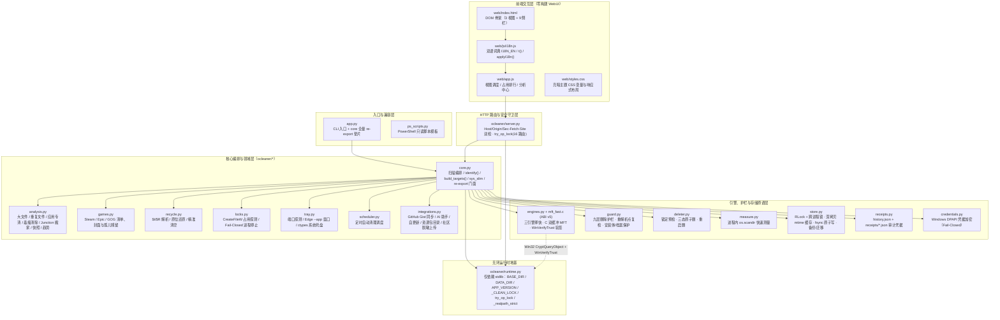

# O-Cleaner 系统架构说明（v2.18）

O-Cleaner 采用**「零第三方运行时依赖」**的模块化分层架构：
- **后端**：Python 3.8+ 标准库 + 纯 Win32 `ctypes` + 可选 GCC 编译的 C 原生加速库（`ocleaner/mft_fast.c`，ABI v5）；
- **前端**：零构建静态三文件（`web/index.html`、`web/styles.css`、`web/js/i18n.js` + `web/app.js`），通过纯标准库 HTTP 服务在本地回环地址 `127.0.0.1` 交互。

---

## 一、总体分层架构图

---

## 二、17 个后端模块清单与职责

| 模块 | 职责说明 | 依赖特征 |
|---|---|---|
| `ocleaner/runtime.py` | 无环运行时地基：`BASE_DIR` / `DATA_DIR` / `CONFIG_DIR` / `WEB_DIR` / `RUNTIME_DIR`、`APP_VERSION`、`IS_WINDOWS`、`CREATE_NO_WINDOW`、`_cfg_or_bundled()`、`_CLEAN_LOCK`、`try_op_lock()`、`_realpath_strict()` | **仅依赖 stdlib**，不导入任何 `ocleaner.*` |
| `ocleaner/core.py` | 扫描编排、`identify()` / `build_targets()` / `_safe_eval_unit_expr()`、`run_ps()`（剔除 `PSModulePath`）、`_authenticode_info()`（Win32 原生验签）、`sys_slim_*`、并全量 re-export 子模块符号 | 保持与 `app.py`、`selftest.py`、`unit_test.py` 100% monkeypatch 兼容 |
| `ocleaner/server.py` | `Handler`（`GET` / `POST` / `DELETE`）、`_host_ok` / `_origin_ok`（严格端口 + `Sec-Fetch-Site`）、`/js/<name>.js` 白名单静态服务、16 条写盘路由统一 `try_op_lock` 串行互斥 | 惰性引用 `_core.*` |
| `ocleaner/engines.py` + `mft_fast.c` | NTFS `$MFT` 自研直读 + C 双缓冲 Reader（ABI v5）+ WizTree 验签集成 + PS 兜底三引擎择快，跨设备速度校准 | 惰性引用 `_core.*` |
| `ocleaner/guard.py` | 九层路径删除护栏、`check_deletable()`（重解析点 `real_note` 透传、个人数据强制回收站）、浏览器档案与程序本体识别 | 惰性引用 `_core.*` |
| `ocleaner/deleter.py` | 锁定文件预检（命中整项中止）、`rm_tree_strict` 三态原子暂存与中断恢复、`rm_trash`、`MoveFileExW` 重启删除 | 惰性引用 `_core.*` |
| `ocleaner/recycle.py` | `$Recycle.Bin` 容量探测、`$I`/`$R` 二进制解析、`recycle_restore` 原位还原、`purge_recycle_paths` 精准清空 | 惰性引用 `_core.*` |
| `ocleaner/locks.py` | `CreateFileW` 无共享句柄占用探测、`find_lock_holders` 进程候选、`stop_lock_processes` Fail-Closed 安全终止 | 惰性引用 `_core.*` |
| `ocleaner/tray.py` | 裸 `bind` 空闲端口探测、Edge/Chrome `--app` 居中桌面窗、纯 `ctypes` 系统托盘线程与右键菜单 | 惰性引用 `_core.*` |
| `ocleaner/analysis.py` | 分析中心域：大文件排行、重复文件两阶段哈希、毒瘤扫描清扫、Junction 批量搬家迁回、应用专清、下载归档撤销、快照对比、趋势预测 | 惰性引用 `_core.*` |
| `ocleaner/store.py` | `_lock` 可重入锁、跨进程文件锁、128 条深拷贝 `mtime` 缓存（`_load_json`）、`flush+fsync` 原子写（`_atomic_write`）、备份导出与白名单导入、GUI 数据目录迁移 | 惰性引用 `_core.*` |
| `ocleaner/receipts.py` | 锁内原子落盘清理历史与 `data/receipts/cleanup-*.json` 审计回执、畸形回执容错检索 | 惰性引用 `_core.*` |
| `ocleaner/scheduler.py` | 后台守护定时清理线程（锁内读-算-写，防并发覆写 `next_run`） | 惰性引用 `_core.*` |
| `ocleaner/measure.py` | 进程内 `os.scandir` 目录大小 / glob / 目录分类测量原语 | 惰性引用 `_core.*` |
| `ocleaner/credentials.py` | Windows DPAPI `CryptProtectData` / `CryptUnprotectData` 密钥加密（失败 Fail-Closed，用完清零明文缓冲） | 纯 `ctypes` + stdlib |
| `ocleaner/games.py` | Steam VDF / Epic Manifest / GOG 注册表发现、封面解析、孤儿残留检测、周增长趋势 | 惰性引用 `_core.*` |
| `ocleaner/integrations.py` | 私密 GitHub Gist 双向同步、`community_upload()`（`%USERPROFILE%` 与 `<USER>` 脱敏）、自有 OpenAI 兼容 AI 接口、Releases 校验自更新、资源包本机匹配目录 | 惰性引用 `_core.*` |

---

## 三、关键架构设计约定

### 3.1 无环运行时与兼容门面契约
- **无环基础**：所有全局不可变运行期常量、`_CLEAN_LOCK`、`try_op_lock` 与 `_realpath_strict` 下沉至只依赖标准库的 `ocleaner/runtime.py`，根除「子模块在顶层导入阶段反向读取 `core` 尚未初始化符号」的隐患。
- **惰性重导出契约**：`ocleaner/core.py` 对外统一 re-export 全部子模块公共与测试符号，子模块内部跨模块调用与可测常量一律经 `import ocleaner.core as _core` 属性查找。`tools/check_undefined.py` 在每次提交快级 CI 中通过 AST 静态解析强制验证该契约。

### 3.2 三引擎扫描、原生验签与 C ABI v5
- **MFT 直读 C ABI v5**：`ocleaner/mft_fast.c` 实现双缓冲异步盘区读取（`mft_reader_open` / `mft_reader_next`）、单块记录批处理（`mft_scan_chunk`）、扩展名固定哈希统计与目录树聚合（`mft_agg_tree`）。`engines.py` 通过 `memoryview(...).cast("B")` 零拷贝导入密度数组，并在 C 读取异常时自动重置中间状态无缝回退纯 Python。
- **纯 Win32 原生验签（免 PowerShell 污染）**：`_authenticode_info()` 直接调用 `wintrust.WinVerifyTrust`（`WTD_CACHE_ONLY_URL_RETRIEVAL`）与 `crypt32.CryptQueryObject` / `CertGetNameStringW` 校验证书与签名主体（带 64 条 `(realpath, size, mtime_ns)` 缓存），完全不受 PowerShell 7 继承的 `PSModulePath` 环境变量干扰。
- **跨设备自适应择快**：实测引擎耗时存入 `config/engine_speed.json` 并附带本机硬件指纹，复制到新电脑后自动失效重测。

### 3.3 并发原子互斥（`try_op_lock`）与存储一致性
- `server.py` 内全部 **16 条磁盘变更 / 维护路由** 与后台调度器、`sys_slim_run` 共享同一把 `runtime._CLEAN_LOCK`（通过 `try_op_lock(server)` 上下文管理器获取并在 `finally` 中原子释放），彻底消除锁脑裂与异常锁泄漏。
- `store._load_json` 在 `RLock` 保护下返回深度拷贝，防止调用方就地修改字典污染缓存；`store._atomic_write` 在 `flush + fsync + os.replace` 后立刻剔除旧缓存条目，消除 Windows 15.6 ms 文件时间戳粒度的同 tick 脏读。

### 3.4 前端零构建分层加载
- 将 980+ 行的双语字典与译文函数独立至 `web/js/i18n.js`，在 `web/index.html` 中按序 `` → `` 加载，根除早期同步 IIFE 初始化时读取 `const I18N_EN` 触发的 TDZ 崩溃。
- `server.py` 的 `/js/<name>.js` 路由仅接受合法小写字符文件名并严格校验 `.resolve().parent`，无任意文件读取面。

---

## 四、九道工程质量门禁（CI 快慢两级）

| 序号 | 门禁脚本 / 工具 | 检查目标 | 所属 CI 级别 |
|---|---|---|---|
| 1 | `tools/fix-encoding.ps1 -Check` | `.bat`/`.cmd` 纯 ASCII+CRLF、`.ps1` UTF-8 BOM+CRLF、其余文本（含 `.css`/`.c`/`.rc`/`.js`）UTF-8 无 BOM+CRLF | 快级 `lint` |
| 2 | `python -m py_compile` & `pyflakes` | 全仓库 `.py` 语法编译与静态错误检查 | 快级 `lint` |
| 3 | `gcc -Wall -Wextra -Wpedantic -Wconversion -Wshadow` | `ocleaner/mft_fast.c` 与 `tools/launcher.c` 零告警严格编译检查 | 本地发版门禁 |
| 4 | `tools/lint_rules.py --strict` | 知识库 42 条规则与 5 组资源包的语义一致性、关键词边界与文档同步 | 快级 `lint` |
| 5 | `tools/_lint_selftest.py` | 向知识库与资源包反向注入 63 类已知缺陷，证明 linter 具备真实检出能力 | 快级 `lint` |
| 6 | `tools/guard_matrix.py` | 50 项对抗路径样本（根目录/系统子目录/8.3 短名/保留设备名/Junction）护栏矩阵 | 快级 `lint` |
| 7 | `tools/unit_test.py` | 85+ 项纯逻辑快速回归单测（CSRF/DPAPI/SSRF/MFT/缓存/回执/脱敏/调度/验签） | 快级 `lint` |
| 8 | `tools/check_undefined.py` & `tools/audit_dead.py --strict-i18n` | `_core.X` 符号完整 + 全包 AST F821 裸名检查 + CSS/DOM/i18n 全键覆盖校验 | 快级 `lint` |
| 9 | `tools/packs_ci_validate.py` + `node --check` | 社区资源包 SHA-256 与索引校验 + 全前端 `.js` 与内联 `<script>` 语法检查 | 快级 `lint` |
| 10 | `tools/selftest.py` & `tools/cdp_check.js` | 全量端到端自测（含沙箱真实清理）+ 真实 Edge CDP 中英文界面与全功能巡检 | 慢级 `test` & `ui` |
